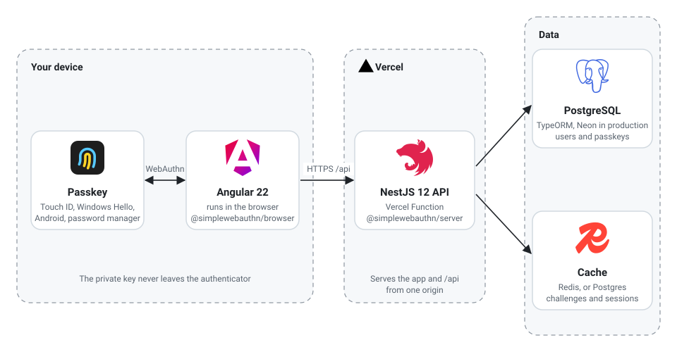
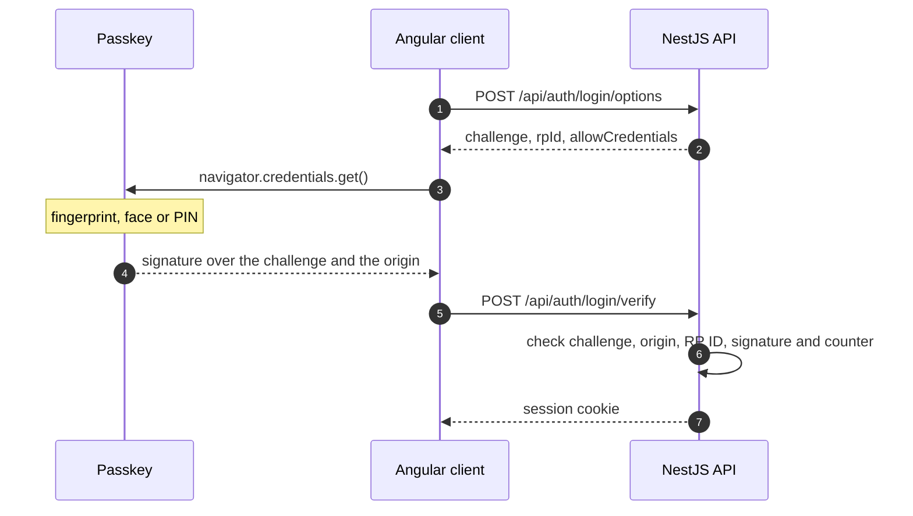
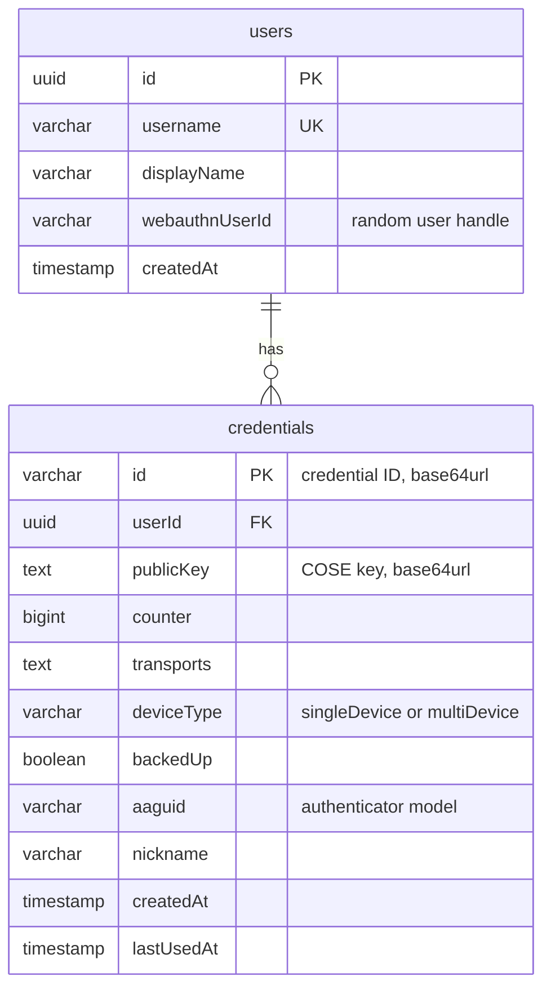

# ng-passkeys

Passwordless sign-in with WebAuthn passkeys. Angular 22, NestJS 12, Nx 24 and SimpleWebAuthn 14.

Live at https://ng-passkeys.vercel.app

## Run it

Node 22.22 or newer.

```bash
npm ci
npm start
```

Open http://localhost:4200. With no configuration the API keeps users in a local SQLite file and
challenges in memory, so there is nothing else to install. Set `DATABASE_URL` and `REDIS_URL` to
use Postgres and Redis instead.

## What to try

- Create an account and look at the passkey card. It shows the BE and BS flags (whether the passkey
  can sync and whether it is backed up) and the provider read from the AAGUID.
- Sign out and sign in with the username empty. The server sends an empty `allowCredentials` and
  finds the account from the user handle.
- Reload and click the username field. Conditional UI offers the passkey in the autofill list.
- Open _Last WebAuthn response_ to see what the browser sent, with `clientDataJSON` decoded.

## Architecture

<p align="center">
  
</p>

- **Passkey.** Lives in Touch ID, Windows Hello, Android or a password manager. The private key
  never leaves it; the browser only gets a signature.
- **Angular client.** Asks the browser to create or use a passkey through `@simplewebauthn/browser`
  and sends the result to the API.
- **NestJS API.** Creates single-use challenges, verifies responses with `@simplewebauthn/server`
  and keeps the session id in a signed, HttpOnly cookie. On Vercel it runs as a function on the same
  origin as the app.
- **Cache.** Challenges (five minutes, single use) and sessions. Redis when `REDIS_URL` is set,
  otherwise Postgres, or memory locally.
- **Database.** Users and their passkeys in Postgres (Neon on Vercel), SQLite locally.

### Sign-in



Creating an account follows the same steps with `register/options`, `navigator.credentials.create()`
and `register/verify`. The account is saved only once its passkey is verified.

### Database



## Stack

|               |                                                                     |
| ------------- | ------------------------------------------------------------------- |
| `apps/web`    | Angular 22: signals, `httpResource`, Signal Forms, RxJS, Material 3 |
| `apps/api`    | NestJS 12: TypeORM, `@nestjs/cache-manager`, `@nestjs/config`       |
| `libs/shared` | contracts shared by both apps                                       |
| `e2e`         | Playwright tests with Chrome's virtual authenticator                |

## Scripts

|               |                                                                                             |
| ------------- | ------------------------------------------------------------------------------------------- |
| `npm start`   | API on :3000, web on :4200                                                                  |
| `npm test`    | Node test runner for the API, Vitest for the web                                            |
| `npm run e2e` | sign up, sign in and validation in Chrome, desktop and mobile, with a virtual authenticator |

The e2e tests run against production too:

```bash
BASE_URL=https://ng-passkeys.vercel.app npm run e2e
```

## Configuration

| Variable          | Default                                               |
| ----------------- | ----------------------------------------------------- |
| `WEBAUTHN_RP_ID`  | `localhost`. A domain, never an origin                |
| `WEBAUTHN_ORIGIN` | `http://localhost:4200`. Comma separated              |
| `SESSION_SECRET`  | required in production                                |
| `DATABASE_URL`    | unset: SQLite in `.data/`                             |
| `REDIS_URL`       | unset: Postgres if `DATABASE_URL` is set, else memory |

The API refuses to start when the RP ID cannot work with the configured origins.

## Deploy

The live demo runs on Vercel's free plan. The Angular build and the NestJS API share one origin
(`api/index.js`), and Neon Postgres holds users, credentials, challenges and sessions. Set
`REDIS_URL` (Upstash) to move challenges and sessions to Redis.

Two settings matter on Vercel:

- `NODEJS_HELPERS=0`. Vercel's request helpers define `req.cookies` before Express runs, and
  cookie-parser then skips signed cookies.
- `WEBAUTHN_RP_ID` and `WEBAUTHN_ORIGIN` set to the production domain. Preview deployments get
  their own hostname, so passkeys only work on production.

## Credits

The capybara on the sign-in page is from a GIF by
[Guillermo Menéndez](https://www.inaturalist.org/photos/358045025) on iNaturalist, licensed
[CC BY-NC 4.0](https://creativecommons.org/licenses/by-nc/4.0/). It was cropped and shortened, and
the MIT license below does not cover it.

## License

MIT
